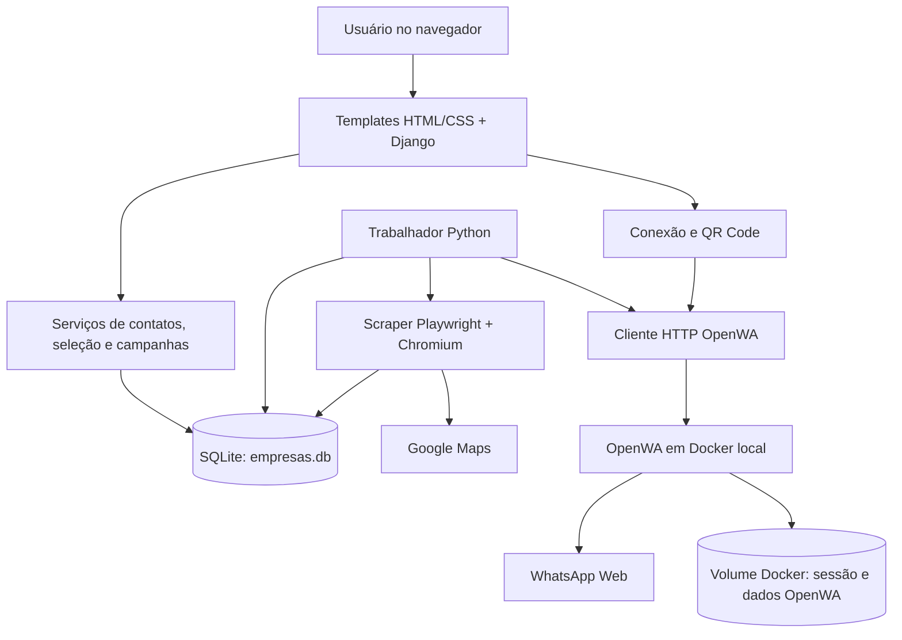

# AutoLeads — automação de busca de leads e primeiro contato

O AutoLeads automatiza a busca de leads por web scraping no Google Maps e permite criar campanhas com fluxo automático de envio de mensagens pelo WhatsApp para primeiro contato.

## Qual problema o projeto resolve?

Buscar possíveis clientes manualmente exige repetir várias tarefas: pesquisar empresas por atividade e cidade, abrir cada resultado, copiar os dados de contato, organizar uma lista e enviar as mensagens de apresentação uma a uma.

O projeto reúne essas etapas em uma automação de tarefas: coleta os dados disponíveis no Google Maps, organiza os contatos e executa o fluxo de mensagens de uma campanha após a revisão da prévia e o início autorizado pelo usuário. Isso reduz o trabalho repetitivo na montagem de listas de leads e no primeiro contato comercial.

O usuário define o que pesquisar, escolhe os destinatários e o texto e inicia a campanha. A partir daí, o sistema processa os envios com o intervalo configurado e registra as tentativas para acompanhamento. A operação acontece em um painel local em português.

Desenvolvido com apoio de inteligência artificial na construção do software. A aplicação funciona com regras e automações em Python: não utiliza IA para ler conversas, classificar interesse ou gerar respostas automáticas.

## O que você pode fazer

| Serviço | Uso no dia a dia |
| --- | --- |
| Pesquisas | Buscar empresas por atividade e cidade, com um termo por linha e limite de resultados por termo. |
| Cadastro de contatos | Consultar nome, endereço, telefone, site e avaliação; corrigir dados e manter a origem das pesquisas. |
| Tags e regras | Organizar empresas por ramo e categoria e aplicar classificações nas próximas capturas, respeitando correções manuais. |
| Segmentação | Filtrar por nome, localidade, classificação, presença de telefone e último disparo. |
| Textos salvos | Reutilizar mensagens com campos personalizados para cada empresa. |
| Campanhas | Escolher clientes manualmente ou definir quantidades por grupo, revisar a prévia e iniciar, pausar ou retomar o processamento. |
| Histórico | Acompanhar tentativas, horários, erros e evidências de envio, entrega e leitura disponíveis na integração. |
| Conexão WhatsApp | Consultar a disponibilidade do OpenWA e conectar a sessão por QR Code no painel local. |

Por exemplo, um prestador de serviços pode pesquisar empresas de determinado ramo em sua cidade, revisar os cadastros encontrados, separar os contatos por categoria e preparar uma comunicação para destinatários que esperam esse contato. A pesquisa e a preparação da campanha não enviam mensagens por si só.

## Como usar o painel

1. Em **Pesquisas**, informe termos como `Cafeteria Pato Branco`, um por linha. O trabalhador executa a coleta e registra os resultados e o progresso.
2. Em **Contatos**, revise as informações capturadas e corrija dados ou tags. Em **Tags e regras**, configure os critérios para as próximas pesquisas.
3. Em **Textos**, salve a mensagem. Os campos disponíveis são `{nome}`, `{endereco}`, `{telefone}`, `{site}` e `{avaliacao}`.
4. Em **Campanhas**, selecione os contatos, informe o intervalo entre mensagens e prepare a prévia. Confira destinatários, exclusões e mensagens personalizadas.
5. Em **WhatsApp**, conecte a sessão quando necessário. Na prévia, clique em **Iniciar campanha** para autorizar o processamento.
6. Acompanhe o andamento e consulte **Histórico** para verificar o resultado de cada tentativa.

Campos ausentes na personalização viram texto vazio. Use `{{` e `}}` para escrever chaves literais. A mensagem final deve ter de 1 a 4096 caracteres. Os telefones seguem o formato brasileiro, com DDD; o sistema não inventa DDD nem acrescenta o nono dígito.

Os grupos de seleção são categorias internas de empresas, não grupos de WhatsApp.

## Automações e controle dos envios

O trabalhador Python roda em processo separado do painel. Seu ciclo executa pesquisas pendentes, consulta recibos e processa envios de campanhas ativas. Ele precisa permanecer em execução para essas tarefas avançarem.

- **Coleta e organização:** o Playwright captura os dados e o sistema registra as origens das pesquisas, deduplica empresas e aplica regras de tags.
- **Preparação:** a seleção normaliza e deduplica telefones antes de aplicar os limites. A prévia guarda cópias dos destinatários e das mensagens; editar um texto salvo depois não altera a campanha preparada.
- **Processamento com intervalo:** somente campanhas iniciadas explicitamente entram no fluxo de envio. Uma reserva é persistida antes da chamada ao OpenWA para controlar repetição por sessão, telefone e hash do texto final.
- **Acompanhamento:** o sistema consulta recibos e registra as transições disponíveis. Um `messageId` retornado pela API representa aceitação, não comprova entrega ou leitura.
- **Interrupções:** resultados incertos ficam pendentes de verificação e não são repetidos automaticamente. Reenvios exigem ação explícita e preservam a tentativa anterior.
- **Desconexão:** o processamento pausa os próximos envios ao detectar indisponibilidade. Reconectar não retoma campanhas automaticamente.

Não há garantia de exatamente uma entrega entre a aplicação local e um serviço externo. O controle de reservas reduz o risco de duplicação, e situações incertas exigem conferência antes de qualquer reenvio. O último disparo depende de confirmação, não apenas de uma tentativa ou aceitação da API.

## Arquitetura



| Camada | Responsabilidade | Local no projeto |
| --- | --- | --- |
| Interface | Formulários, filtros, prévias, histórico e conexão | `painel/views.py`, `painel/forms.py`, `painel/templates/`, `painel/static/` |
| Regras de negócio | Classificação, contatos, seleção, campanhas, reservas e recibos | `painel/services/` |
| Persistência | Modelos Django, migrações e compatibilidade com o banco do scraper | `painel/models.py`, `painel/migrations/` |
| Coleta | Navegação e captura de empresas no Google Maps | `test_scrapy.py` |
| Integração | Cliente HTTP e comandos de terminal para o OpenWA | `mensagens_openwa.py`, `painel/services/integration.py` |
| Execução em segundo plano | Pesquisa, envio, recuperação e consulta de recibos | `painel/services/worker.py`, `manage.py trabalhador` |
| Inicialização Windows | Preparação do banco, controle de processos e parada | `iniciar.py`, `parar.py`, `controle_lancador.py` |
| Serviço WhatsApp | Container e volume persistente do OpenWA | `compose.openwa.yaml`, `iniciar_openwa.ps1` |

**Stack:** Python, Django 5.2.17, templates HTML/CSS, SQLite3, Playwright e OpenWA em Docker. O painel não depende de React, Redis ou Celery. O OpenWA continua sendo executado em seu próprio container, separado do processo Python.

O painel usa `http://127.0.0.1:8000/` por padrão e o OpenWA usa `http://127.0.0.1:2785`. Os horários são apresentados em `America/Sao_Paulo`, com suporte a fuso na persistência.

## Instalação em outra máquina

O caminho de inicialização automatizado foi desenvolvido para **Windows com PowerShell**. O ambiente existente utiliza Python 3.14; a instalação em uma máquina limpa deve ser validada no destino. Docker Desktop com Docker Compose é necessário apenas para a integração WhatsApp. As pesquisas precisam de internet e do Chromium instalado pelo Playwright.

### 1. Baixar o código e instalar as dependências

Instale Python, Git e, se for usar o WhatsApp, Docker Desktop. No PowerShell:

```powershell
git clone https://github.com/KaduFelipy/AutoLeads.git ScrapGoogleMaps
cd ScrapGoogleMaps
python -m venv venv
.\venv\Scripts\python.exe -m pip install -r requirements.txt
.\venv\Scripts\python.exe -m playwright install chromium
```

Os comandos usam diretamente o Python do ambiente virtual; não é necessário ativar o ambiente nem alterar a política de execução para ativá-lo.

### 2. Iniciar sem configurar WhatsApp

```powershell
.\venv\Scripts\python.exe iniciar.py --sem-openwa
```

Acesse [o painel local](http://127.0.0.1:8000/). Esse modo permite usar pesquisas e organização de contatos sem tentar iniciar o container OpenWA. A opção não desativa uma sessão OpenWA que já esteja configurada e em execução; o trabalhador continua ativo.

O iniciador prepara o banco, aplica as migrações, inicia o painel e o trabalhador em segundo plano e abre o navegador. Se houver um banco preexistente, a preparação usa backup consistente do SQLite e valida as migrações em uma cópia antes de aplicá-las ao banco configurado.

### 3. Configurar a integração WhatsApp

Com o Docker Desktop aberto, execute:

```powershell
.\iniciar_openwa.ps1
.\venv\Scripts\python.exe iniciar.py
```

O script gera uma chave aleatória em `openwa.env`, baixa a imagem configurada e inicia o OpenWA local. Se o painel já estiver ativo, o iniciador evita abrir uma segunda instância.

Abra **WhatsApp** no painel, solicite a conexão e leia o QR Code no aplicativo do celular, em **Aparelhos conectados → Conectar um aparelho**. Aguarde a indicação de conexão pronta antes de iniciar uma campanha.

Como alternativa ao painel:

```powershell
.\venv\Scripts\python.exe mensagens_openwa.py conectar
.\venv\Scripts\python.exe mensagens_openwa.py status
```

O comando de conexão pode gerar `openwa-qr.png`; o QR expira e não deve ser compartilhado. A chave e o identificador da sessão ficam na configuração local.

O Compose aceita `OPENWA_IMAGE` em `openwa.env` para fixar a imagem por digest. Sem essa definição, usa a tag `latest`; uma instalação nova pode receber uma versão diferente. Preserve o digest de uma instalação validada e `WWEBJS_WEB_VERSION=off` ao reproduzir o ambiente. O script de configuração não fixa o digest automaticamente.

### 4. Encerrar ou ajustar a inicialização

```powershell
.\venv\Scripts\python.exe parar.py
```

Esse comando encerra os processos do projeto e tenta parar o OpenWA sem remover bancos, volumes ou sessão. Se a parada do Docker falhar, confira o Docker Desktop. Para iniciar sem abrir o navegador ou usar outra porta:

```powershell
.\venv\Scripts\python.exe iniciar.py --nao-abrir --porta 8010
```

Se uma inicialização ficar incompleta, execute `parar.py` antes de iniciar novamente. Os logs do iniciador ficam na pasta `ScrapGoogleMaps` dentro do diretório temporário do Windows.

## Instalação e acesso remoto

Para executar em um computador Windows remoto, acesse essa máquina por uma conexão remota já configurada e execute nela as etapas de instalação acima. O repositório distribui o código; banco, dependências, configuração e sessão são criados no destino. Use o navegador dentro da sessão remota para operar o painel.

Se a máquina já oferecer acesso SSH autorizado, outra opção é encaminhar somente a porta do painel. Execute no computador de onde fará o acesso, substituindo `USUARIO` e `HOST`:

```powershell
ssh -N -L 8000:127.0.0.1:8000 USUARIO@HOST
```

Com o painel iniciado na máquina remota e o túnel aberto, acesse `http://127.0.0.1:8000/` no navegador do seu computador. A porta local 8000 deve estar livre. Não é necessário encaminhar a porta do OpenWA: o Django o acessa na própria máquina remota.

Esse procedimento depende de SSH ou acesso remoto já instalado e autorizado; o projeto não configura esses serviços. O acesso por túnel e a instalação em servidor remoto não foram validados nesta revisão do README.

**O projeto foi desenhado para operação local.** O iniciador usa o servidor de desenvolvimento do Django, inclusive para servir arquivos estáticos. Não é uma configuração de hospedagem pública: mantenha o bind em `127.0.0.1` e as portas 8000 e 2785 fora da internet. Uma versão pública multiusuário exigiria revisão de autenticação, servidor de aplicação e arquitetura. O iniciador Windows também não constitui suporte validado a Linux.

## Comandos de terminal

Para consultar contatos e conferir uma mensagem sem enviar:

```powershell
.\venv\Scripts\python.exe mensagens_openwa.py listar --nome "Caf" --endereco "Pato Branco" --avaliacao-min 4 --limite 10
.\venv\Scripts\python.exe mensagens_openwa.py prever --nome "Caf" --endereco "Pato Branco" --limite 10 --mensagem "Olá, {nome}! Podemos conversar sobre nosso serviço?"
```

Os filtros se combinam; nome e endereço usam busca por trecho sem distinguir maiúsculas ou acentos. `--ids 1 2 3` restringe as empresas selecionadas. A prévia de terminal não acessa o OpenWA nem grava histórico. Telefones ausentes ou inválidos são ignorados e cada telefone aparece uma única vez no lote.

O cliente também oferece `enviar` para processamento pelo terminal. Esse comando produz envios reais e não passa pela prévia do painel: use somente após conferir o lote e autorizar destinatários e texto. Para a operação cotidiana, prefira o fluxo de prévia e início explícito no painel. `--arquivo mensagem.txt` aceita texto UTF-8 no lugar de `--mensagem`; `--banco outro.db` aponta para outro banco compatível.

O histórico legado do cliente usa estados como `processando`, `aceita`, `sem_whatsapp`, `falha` e `incerto`. O painel mantém tentativas e eventos próprios para acompanhar também confirmações de envio, entrega e leitura; os estados dos dois fluxos não são equivalentes em todos os detalhes.

Para consultar o container:

```powershell
docker compose --env-file openwa.env -f compose.openwa.yaml ps
docker compose --env-file openwa.env -f compose.openwa.yaml logs --tail 50
```

## Dados locais e segurança

- O banco `empresas.db` guarda contatos, pesquisas e o histórico funcional do painel. Os dados e a sessão do OpenWA ficam em um volume Docker separado.
- Bancos, backups, `openwa.env`, `.django-secret` e QR Code não devem ser publicados. O `.gitignore` contém exclusões para esses arquivos, mas isso não substitui a revisão do conteúdo antes de enviar ao GitHub.
- A aplicação usa CSRF, validação no servidor e escape de conteúdo nos templates. A configuração restringe os hosts e o endereço de integração ao ambiente local.
- Antes de alterações estruturais em dados existentes, use a preparação com backup consistente. Não copie apenas o arquivo principal de um SQLite ativo em WAL.
- Uma instalação nova deve gerar sua própria configuração. Não transporte credenciais ou sessão WhatsApp pelo repositório.

## Verificações automatizadas

Na raiz do projeto, com as dependências instaladas:

```powershell
.\venv\Scripts\python.exe -m unittest discover -s tests -v
.\venv\Scripts\python.exe manage.py check
.\venv\Scripts\python.exe manage.py makemigrations --check --dry-run
.\venv\Scripts\python.exe manage.py test
```

Os testes automatizados usam dados sintéticos, SQLite temporário ou em memória e simulações de navegação e HTTP do OpenWA. A configuração Django define banco de teste em memória. Os comandos acima são as verificações do projeto, não uma declaração de execução ou aprovação nesta revisão da documentação.

**Não execute `test_consultaGoogleMaps` como teste isolado de rotina:** ele faz pesquisa real. A execução direta abaixo também consulta o Google Maps de verdade:

```powershell
.\venv\Scripts\python.exe test_scrapy.py "Cafeteria Pato Branco"
```

## Limitações e uso responsável

A coleta depende da estrutura e da disponibilidade do Google Maps; mudanças na página podem exigir manutenção. Os resultados podem ter dados ausentes ou desatualizados e devem ser revisados antes do uso.

O OpenWA usa uma integração não oficial com o WhatsApp, sujeita a mudanças e restrição da conta. Use contatos que esperam suas mensagens e respeite as condições das plataformas. O projeto não é uma ferramenta de leitura de conversas, análise de interesse ou atendimento por IA.

Referências da integração: [repositório OpenWA](https://github.com/rmyndharis/OpenWA) e [contrato HTTP OpenAPI](https://github.com/rmyndharis/OpenWA/blob/main/openapi.json).
